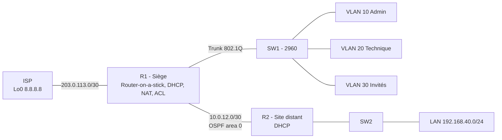

# Lab réseau d'entreprise – CCNA

Lab Cisco qui simule le réseau d'une PME : un siège avec plusieurs services et un site distant, avec une sortie Internet. Il couvre les grands thèmes du CCNA 200-301 : VLAN, trunk 802.1Q, routage inter-VLAN, OSPF, DHCP, NAT/PAT, ACL et administration sécurisée par SSH.

**Outils :** Cisco Packet Tracer 8.x (compatible GNS3 avec des images IOSv)

## Topologie

## Fonctionnalités

| Thème | Mise en œuvre |
|---|---|
| VLAN | 10 Admin, 20 Technique, 30 Invités, 99 Management (natif) |
| Trunk | 802.1Q entre SW1 et R1, VLAN natif 99, VLAN autorisés limités |
| Inter-VLAN | Router-on-a-stick (sous-interfaces sur R1) |
| Routage dynamique | OSPFv2 area 0 entre R1 et R2, route par défaut propagée |
| DHCP | Pools sur R1 (VLAN 10/20/30) et R2 (LAN distant), plages exclues |
| NAT | PAT (overload) vers l'ISP pour tous les LAN internes |
| Sécurité | ACL qui isole le VLAN Invités, SSH v2, ports inutilisés désactivés |

## Contenu du dépôt

- [`docs/plan-adressage.md`](docs/plan-adressage.md) : plan d'adressage et affectation des ports
- [`configs/`](configs/) : configurations complètes de R1, R2, SW1 et ISP
- [`docs/verification.md`](docs/verification.md) : commandes de vérification et tests attendus
- `captures/` : captures d'écran des tests

## Mise en place

1. Créer la topologie dans Packet Tracer (routeurs 2911, switchs 2960) en suivant le câblage de `docs/plan-adressage.md`.
2. Coller chaque fichier de `configs/` dans le CLI de l'équipement correspondant.
3. Sur R1, R2 et SW1, générer les clés SSH : `crypto key generate rsa` puis taille `2048`.
4. Passer les PC en DHCP et dérouler les tests de `docs/verification.md`.

> Les mots de passe des configs sont des valeurs de lab (`CHANGE_ME`) à remplacer.

## Avancement

- [x] Plan d'adressage et configurations
- [ ] Topologie montée dans Packet Tracer (fichier `.pkt` à ajouter)
- [ ] Tests de vérification effectués et capturés
- [ ] Extension : redondance HSRP, IPv6, Syslog/NTP

## Auteur

Youssef Bahannis, ingénieur électronique et réseaux de télécommunications (INSA Rennes)
